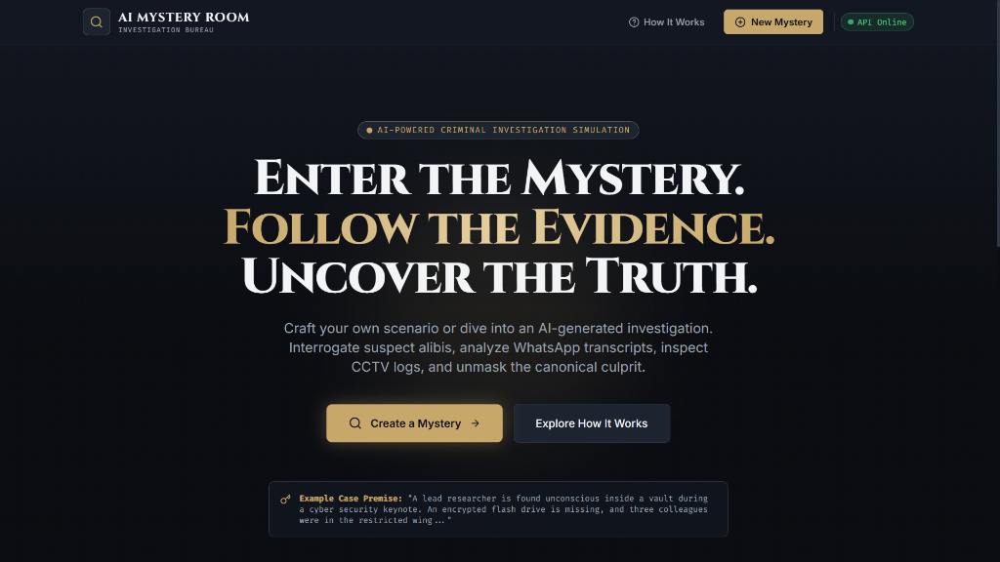
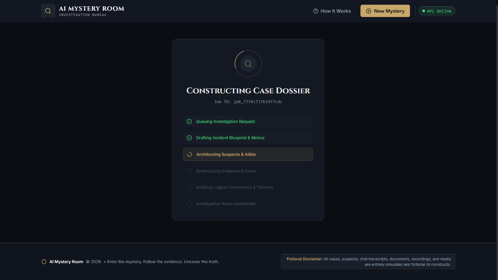
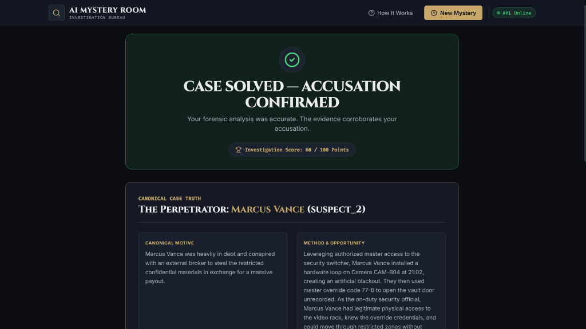
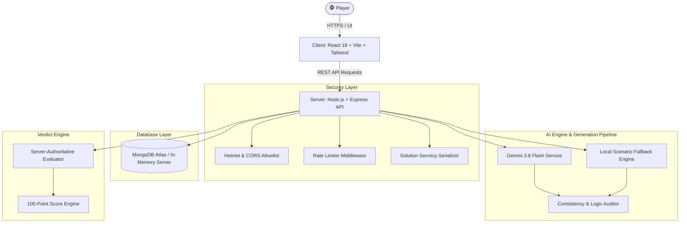

<div align="center">

# 🕵️‍♂️ AI MYSTERY ROOM
### *Interactive AI-Powered Criminal Investigation Simulation Platform*

<br />

<!-- ═══════════════════════════════════════════════════════════════ -->
<!-- 🔥 HIGH-CONVERTING HERO CTA BUTTON: LIVE DEPLOYED APP -->
<!-- ═══════════════════════════════════════════════════════════════ -->

<a href="https://ai-mystery-room.antideploy.app" target="_blank" rel="noopener noreferrer">
  
</a>

<br /><br />

<a href="https://ai-mystery-room.antideploy.app" target="_blank" rel="noopener noreferrer">
  
</a>
<a href="https://ai-mystery-room.antideploy.app" target="_blank" rel="noopener noreferrer">
  
</a>
<a href="https://ai-mystery-room.antideploy.app" target="_blank" rel="noopener noreferrer">
  
</a>

<br /><br />

[](https://www.mongodb.com/)
[](https://ai.google.dev/)
[](https://vitejs.dev/)
[](https://tailwindcss.com/)
[](https://ai-mystery-room.antideploy.app)
[](https://vitest.dev/)
[](LICENSE)

<br />

> **"Enter the mystery. Follow the evidence. Uncover the truth."**
<br />
Transform any premise into a logically consistent crime investigation. Interrogate suspect alibis, analyze recovered WhatsApp chats, inspect CCTV surveillance logs, and unmask the canonical culprit before delivering your final verdict.

---

</div>

> [!TIP]
> ### 🚨 **Try It Instantly in Your Browser!**
> No cloning, terminal commands, or setup required. Launch the live deployment immediately:
> 
> # 🌐 [👉 CLICK HERE TO LAUNCH: ai-mystery-room.antideploy.app 👈](https://ai-mystery-room.antideploy.app)
> 
> *Full AI Generation, Dynamic Evidence Room, Interactive Suspect Interrogations, and Automated Scoring are running 24/7 on Antideploy.*

---

## 📑 Table of Contents

- [🌐 Live Online Demo (Instant Access)](#-live-online-demo-instant-access)
- [✨ Visual Showcase](#-visual-showcase)
- [⚡ Why AI Mystery Room is Unique](#-why-ai-mystery-room-is-unique)
- [🧩 Investigation Room Features](#-investigation-room-features)
- [🏗️ System Architecture](#️-system-architecture)
- [🚀 Quickstart & Local Installation](#-quickstart--local-installation)
- [🧪 Automated Test Suite](#-automated-test-suite)
- [📡 REST API Endpoints](#-rest-api-endpoints)
- [🛡️ Security & Fair-Play Guarantees](#️-security--fair-play-guarantees)
- [🔧 Troubleshooting](#-troubleshooting)
- [📚 Documentation Links](#-documentation-links)

---

## 🌐 Live Online Demo (Instant Access)

The complete AI Mystery Room platform is continuously built and deployed on **[Antideploy](https://ai-mystery-room.antideploy.app)**. You can test and solve cases immediately without running a local development server or provisioning local MongoDB/Gemini instances.

| 🕹️ Module | 🌟 Cloud Status | 🔗 Direct Action |
|---|---|---|
| **Crime Scene Hub** | `🟢 Live & Operational` | [👉 **Open ai-mystery-room.antideploy.app**](https://ai-mystery-room.antideploy.app) |
| **Premise Generator** | `🟢 Gemini 3.8 Flash Active` | [Generate New Case File](https://ai-mystery-room.antideploy.app) |
| **Suspect Interrogation** | `🟢 Real-Time Dialogue Ready` | [Question Suspect Alibis](https://ai-mystery-room.antideploy.app) |
| **Forensic Evidence Vault** | `🟢 WhatsApp, CCTV & Timelines` | [Inspect Physical & Digital Clues](https://ai-mystery-room.antideploy.app) |
| **Automated Accusation Scoring** | `🟢 100-Point Rule Engine` | [Deliver Final Accusation](https://ai-mystery-room.antideploy.app) |

---

## ✨ Visual Showcase

<div align="center">

### 1. Investigation Bureau & Landing Experience
*Cinematic dark investigation aesthetic (`#0B0D12` / `#C7A86A`) with active API status monitoring.*
<br /><br />


<br /><br />

### 2. Live Case Dossier Synthesis
*Multi-stage background job pipeline synthesizing incident blueprint, suspects, clues, and timeline consistency.*
<br /><br />


<br /><br />

### 3. Server-Authoritative Verdict & Solution Reveal
*Deterministic culprit validation, 100-point forensic scoring, timeline reconciliation, and red herring analysis.*
<br /><br />


</div>

---

## ⚡ Why AI Mystery Room is Unique

Traditional mystery games rely on fixed, static scripts with zero replayability. Generic AI chatbots, on the other hand, suffer from hallucination and change the culprit mid-story. **AI Mystery Room bridges both worlds:**

| Core Principle | How AI Mystery Room Implements It |
|---|---|
| 🔒 **Deterministic Truth** | The canonical culprit ID is permanently locked into a protected database record upon case generation. The AI model is never allowed to guess or rewrite the culprit. |
| 🕵️‍♂️ **Investigation Over Random Guessing** | Every case contains a fair path to the solution. Contradictions between alibis, keycard logs, and surveillance feeds allow pure deductive reasoning. |
| 🛡️ **Zero-Leak Solution Secrecy** | Public endpoints scrub the solution via model serializers (`select: false` & `.toPublicJSON()`). Clue data can never be inspected by checking browser devtools or local storage. |
| 🪤 **Fair Red Herrings** | Misleading clues intentionally implicate innocent suspects, but every red herring has an explicit, fair explanation that can be refuted by cross-referencing timeline evidence. |
| 🔄 **Zero-Config Resilient Fallbacks** | If external MongoDB or Gemini credentials are not supplied, the app automatically runs on an embedded in-memory database and procedural scenario engine — zero crashes out of the box. |

---

## 🧩 Investigation Room Features

```
┌────────────────────────────────────────────────────────────────────────┐
│                        INVESTIGATION DASHBOARD                         │
├───────────────┬────────────────────────────────────────────────────────┤
│ 📋 Briefing   │ Incident location, time window, and initial report     │
│ 👥 Suspects   │ Dossiers, background histories, and claimed alibis     │
│ 🔍 Evidence   │ WhatsApp chats, CCTV storyboards, access logs          │
│ ⏱️ Timeline   │ Vertical chronological events with suspect linkages    │
│ 📓 Journal    │ Private detective theory scratchpad with clue bookmarks│
└───────────────┴────────────────────────────────────────────────────────┘
```

- **💬 WhatsApp-Style Chat Archives:** Inspect recovered phone logs with speaker alignment, timestamps, and deleted messages.
- **📹 CCTV Surveillance Simulator:** Frame-by-frame storyboards with atmospheric CRT scanlines, camera timestamps, and movement logs.
- **📄 Forensic Records & Access Logs:** Interactive turnstile badge audits, autopsy sheets, and employee email drafts.
- **⚖️ Sworn Witness Statements:** Formal eyewitness depositions highlighting discrepancies and suspicious behavior.
- **🏆 Forensic Scoring System (100 Points):**
  - **60 pts:** Correct culprit accusation
  - **25 pts:** Discovered evidence coverage ratio
  - **15 pts:** Pinned deductions and bookmarked clues

---

## 🏗️ System Architecture



---

## 🚀 Quickstart & Local Installation

> [!NOTE]
> **Prefer to test immediately without cloning or installing dependencies?**  
> Simply open the live cloud deployment in your browser: **[👉 https://ai-mystery-room.antideploy.app](https://ai-mystery-room.antideploy.app)**

### Prerequisites
- **Node.js:** `v18.0.0` or higher (verified on Node `v24+`)
- **Package Manager:** `npm` (v9+)
- **MongoDB:** *(Optional)* — External connection or automatic embedded in-memory database.
- **Google Gemini API Key:** *(Optional)* — Google AI Studio key or built-in local engine fallback.

### 1. Clone Repository & Install Dependencies

```bash
# Clone the repository
git clone https://github.com/your-username/ai-mystery-room.git
cd ai-mystery-room

# Install root dependencies
npm install
```

#### On Windows PowerShell:
```powershell
# Install server dependencies
npm.cmd --prefix server install

# Install client dependencies
npm.cmd --prefix client install
```

#### On macOS / Linux:
```bash
npm --prefix server install
npm --prefix client install
```

---

### 2. Environment Configuration

Copy the example environment file:

```bash
cp .env.example .env
```
*(On Windows PowerShell: `Copy-Item .env.example .env`)*

Configure your `.env` settings:
```env
NODE_ENV=development
PORT=5000

# Optional: MongoDB Connection URI (Leave empty to use embedded in-memory MongoDB)
MONGODB_URI=mongodb://127.0.0.1:27017/ai_mystery_room

# Optional: Google Gemini API Key (Leave empty to use built-in scenario engine)
GEMINI_API_KEY=
GEMINI_MODEL=gemini-3.8-flash

# Frontend Client URL
CLIENT_URL=http://localhost:5173

# Limits & Timeouts
GENERATION_MAX_RETRIES=2
GENERATION_TIMEOUT_MS=90000
MAX_SCENARIO_LENGTH=3000
```

---

### 3. Launch the Application

Start both the backend server and frontend client concurrently:

```bash
# On Windows
npm.cmd run dev

# On macOS / Linux
npm run dev
```

Open your browser:
- 🌐 **Frontend Client:** [http://localhost:5173](http://localhost:5173)
- 🔌 **Backend REST API:** [http://localhost:5000/api/v1](http://localhost:5000/api/v1)
- 🩺 **Health Check:** [http://localhost:5000/api/v1/health](http://localhost:5000/api/v1/health)

---

## 🧪 Automated Test Suite

AI Mystery Room includes comprehensive integration and unit tests covering health checks, job state machines, consistency validation, and solution secrecy guarantees.

Run tests using Vitest:

```bash
# On Windows
npm.cmd test

# On macOS / Linux
npm test
```

### Verified Test Results:
```text
✓ tests/health.test.js (2 tests)
  ✓ GET /api/v1/health returns 200 with status ok
  ✓ GET /api/v1/nonexistent returns 404 with standardized error
✓ tests/mysteryLifecycle.test.js (9 tests)
  ✓ POST /api/v1/mysteries - creates generation job in 202 Accepted
  ✓ GET /api/v1/generation-jobs/:jobId - polls job until ready
  ✓ GET /api/v1/mysteries/:mysteryId - verifies solution secrecy (FR-012)
  ✓ POST /api/v1/mysteries/:mysteryId/sessions - creates investigation session
  ✓ GET /api/v1/sessions/:sessionId - retrieves active session state
  ✓ GET /api/v1/sessions/:sessionId/evidence/:id - inspects evidence & tracks discovery
  ✓ PATCH /api/v1/sessions/:sessionId/progress - bookmarks clues & persists notes
  ✓ POST /api/v1/sessions/:sessionId/verdict - deterministic evaluation reveals canonical solution
  ✓ POST /api/v1/sessions/:sessionId/verdict - duplicate submission returns 409 Conflict

Test Files  2 passed (2)
     Tests  11 passed (11)
```

---

## 📡 REST API Endpoints

All endpoints use JSON and are prefixed with `/api/v1`.

| Method | Endpoint | Description | Status Code |
|:---:|---|---|:---:|
| `GET` | `/health` | API liveness & health check | `200 OK` |
| `POST` | `/mysteries` | Submit premise & start async generation | `202 Accepted` |
| `GET` | `/generation-jobs/:jobId` | Poll case generation progress | `200 OK` |
| `GET` | `/mysteries/:mysteryId` | Retrieve public case briefing & clues | `200 OK` |
| `POST` | `/mysteries/:mysteryId/sessions` | Initialize an anonymous detective session | `201 Created` |
| `GET` | `/sessions/:sessionId` | Retrieve current session state & notes | `200 OK` |
| `GET` | `/sessions/:sessionId/evidence/:id` | Inspect specific evidence item | `200 OK` |
| `PATCH` | `/sessions/:sessionId/progress` | Save bookmarked clues & theory notes | `200 OK` |
| `POST` | `/sessions/:sessionId/verdict` | Submit accusation & reveal canonical solution | `200 OK` |

---

## 🛡️ Security & Fair-Play Guarantees

1. **Prompt Injection Defense:** User scenarios are strictly treated as untrusted data inputs delimited from system prompts.
2. **Solution Secrecy:** Culprit IDs and motives are excluded from public database queries (`select: false`). The client cannot reverse-engineer the solution before submitting a verdict.
3. **Deterministic Verdicts:** Accusations are compared against immutable server-stored IDs rather than freeform text matching.
4. **Anti-Spam & Rate Limiting:** Configured `express-rate-limit` (200 requests / 15 min window) to protect generation pipelines from brute force.
5. **Fictional Content Disclaimer:** All cases, suspects, and chat logs are explicitly tagged as simulated AI constructs.

---

## 🔧 Troubleshooting

<details>
<summary><b>1. PowerShell Execution Policy Error (<code>npm.ps1 cannot be loaded</code>)</b></summary>

Windows PowerShell blocks `.ps1` wrapper scripts by default.  
**Fix:** Run `npm.cmd` and `npx.cmd` instead of `npm`:
```powershell
npm.cmd run dev
```
</details>

<details>
<summary><b>2. MongoDB Connection Timeout or Network Access Error</b></summary>

If your MongoDB Atlas IP whitelist is not configured or you don't have local MongoDB:  
**Fix:** Leave `MONGODB_URI` blank in `.env`. The backend will automatically fall back to the embedded in-memory MongoDB instance.
</details>

<details>
<summary><b>3. Missing or Invalid Gemini API Key</b></summary>

If you don't have a Gemini key or hit quota limits:  
**Fix:** Leave `GEMINI_API_KEY` blank in `.env`. The app will seamlessly utilize the built-in procedural scenario engine with zero crashes.
</details>

---

## 📚 Documentation Links

- 📖 [Master Specification Sheet (SSOT v1.0)](docs/SPEC.md)
- 🔌 [Complete REST API Specification](docs/API.md)
- 🛠️ [Development & Architecture Guide](docs/DEVELOPMENT.md)

---

<div align="center">

Made with ❤️ by detective story enthusiasts.
<br />
<sub>Enter the mystery. Follow the evidence. Uncover the truth.</sub>

</div>
